<p align="center"></p>

# SuperTrend Signal Alerts (MetaTrader 5 and MetaTrader 4)

A free SuperTrend indicator that draws a two-colour trend line and one buy or sell arrow per trend flip, **on closed bars
only**, and sends an alert for each arrow. Optional EMA and RSI filters apply to the arrows and alerts. Source for both
editions, a Python reference of the maths, and the tests that were used to check that the MT5 and MT4 code, the Python
reference and each other all agree.

**Website:** [allanninal.dev/mql5 (indicators)](https://www.allanninal.dev/mql5/#indicators) · [MT4 editions](https://www.allanninal.dev/mql5/#mt4) · [allanninal.dev](https://www.allanninal.dev)
· **Contact:** message me on [LinkedIn](https://www.linkedin.com/in/allanninal/).

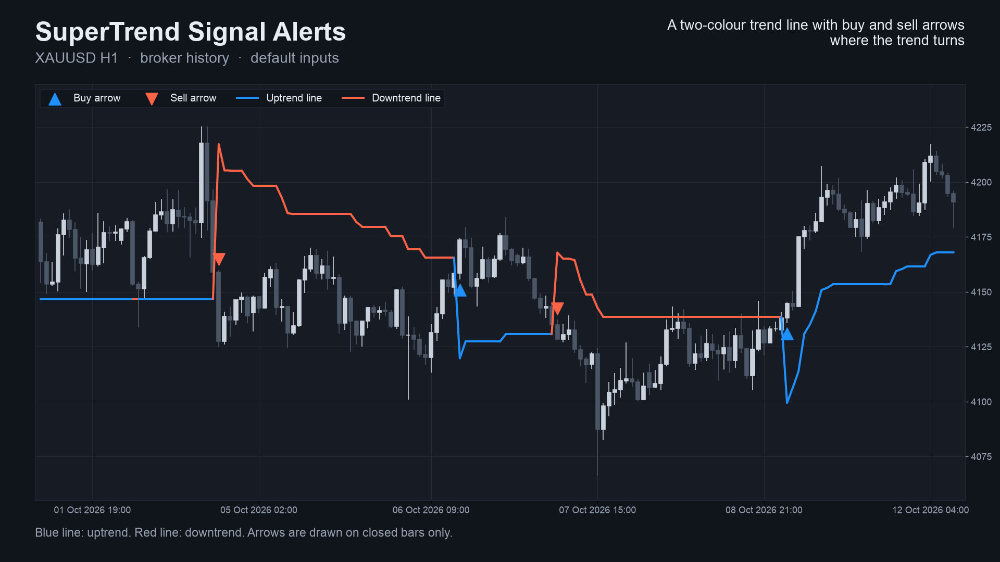

> It is an indicator, not a strategy. It draws a line and arrows and places no trades. Nothing here is a profit claim
> (see [Honest limits](#honest-limits)).

## Get it on the MQL5 Market

| Edition | Platform | Price | Link |
|---|---|---|---|
| SuperTrend Signal Alerts | MT5 | free | <https://www.mql5.com/en/market/product/201882> |
| SuperTrend Signal Alerts MT4 | MT4 | free | <https://www.mql5.com/en/market/product/202324> |

The Market builds are the same calculation as the source in this repository. There is no paid edition of this
indicator: what you see here is the whole product.

## Contents

1. [What it is and who it is for](#what-it-is-and-who-it-is-for)
2. [Why it was built](#why-it-was-built)
3. [How it works](#how-it-works)
4. [Non-repainting: the proof and how it was tested](#non-repainting-the-proof-and-how-it-was-tested)
5. [Architecture and buffers](#architecture-and-buffers)
6. [Inputs, alerts, install and compile](#inputs-alerts-install-and-compile)
7. [Run the Python reference and the tests](#run-the-python-reference-and-the-tests)
8. [Honest limits](#honest-limits)
9. [Free, with no paid edition](#free-with-no-paid-edition)
10. [Licence and credits](#licence-and-credits)

## What it is and who it is for

**What:** the SuperTrend method as a native MetaTrader indicator. Two bands sit `multiplier x ATR` above and below the
bar's middle price and only ratchet in the direction of the trend. While price closes on one side, the line follows the
band on that side. When a close breaks the opposite band the trend flips, the line jumps to the other band, and you get an
arrow (buy below the candle, sell above) and an alert (pop-up, sound, push, e-mail). Two optional filters on the arrows and
alerts: close above or below an EMA, and RSI above or below 50.

**For:** traders who follow trends and want the flip points marked on any symbol and timeframe, and who want to know that
the arrow they saw will still be there tomorrow. Also for developers who want a small, tested indicator with documented
buffers to read from an EA with `iCustom`.

**Not for:** anyone who expects early entries. A trend-following line turns after the move has started, and in sideways
markets it can flip often.

| | |
|---|---|
| 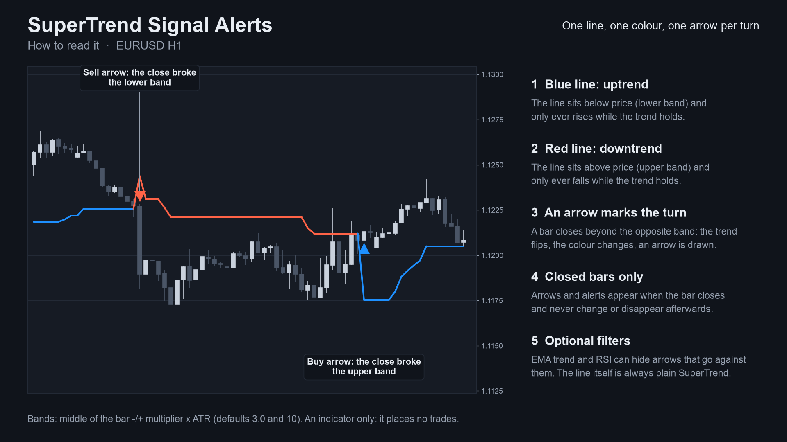 | 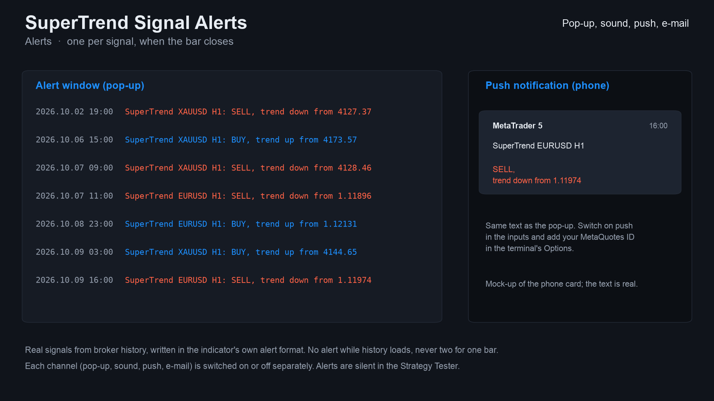 |
| 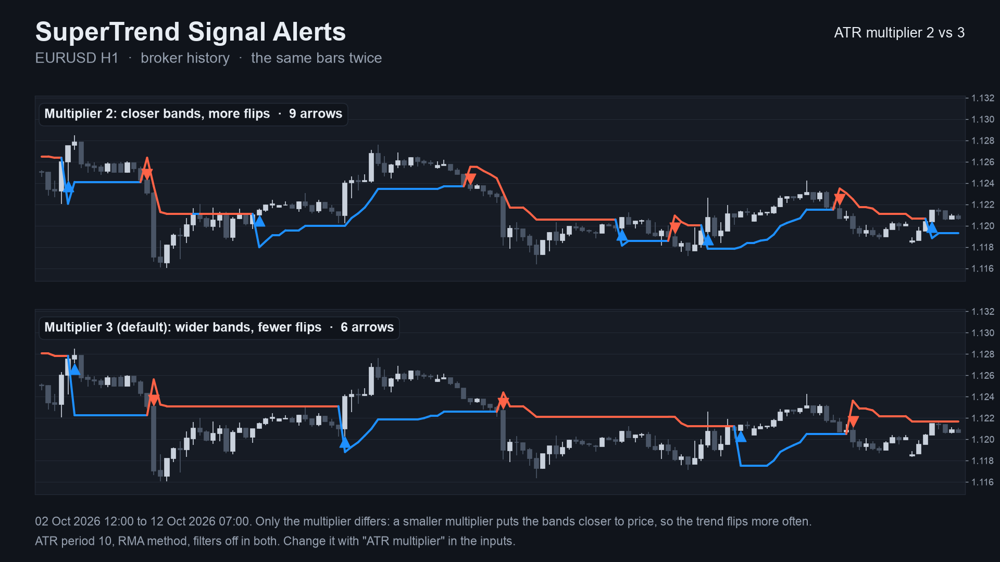 | 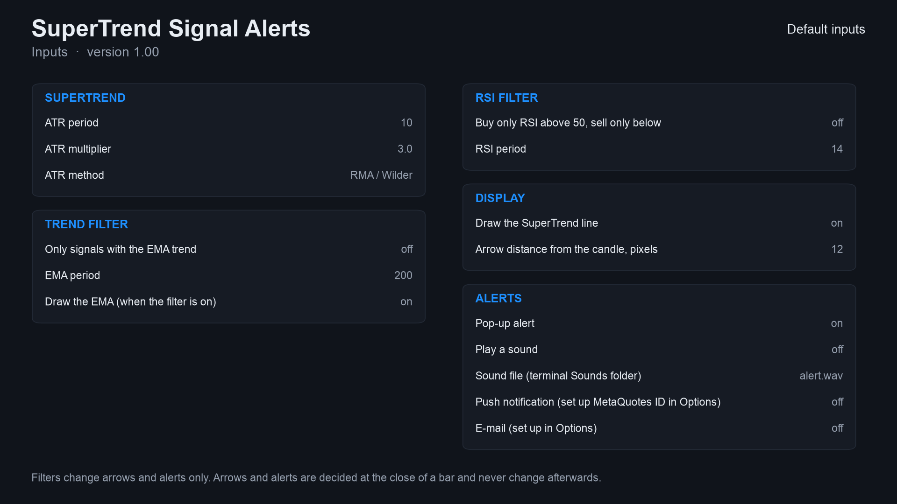 |

Image notes: charts 01-03 are drawn by the Python reference on broker history (the same numbers the indicator shows); the
alert text on 06 is the indicator's real text but the pop-up and phone card around it are mock-ups; the Data Window panel
on 08 is a mock-up of the buffer map. They are illustrations, not terminal captures. MT4 versions are in
[`docs/images/mt4/`](docs/images/mt4).

## Why it was built

SuperTrend is one of the most widely used trend lines on TradingView, and traders who move to MetaTrader ask for it. The
motivations, stated with the evidence we actually have:

- **A native, readable port.** The method is a few lines of arithmetic and does not need a closed-source box.
- **Trust in the arrows.** Our market research (demand scan of MQL5 Market, forums and freelance boards, October 2026)
  found repeated complaints about arrow indicators that repaint, and a 2026-07 request for "arrows confirmed on bar
  close". The design rule follows: an arrow is only drawn on a bar that has closed, and never moves afterwards.
- **Honest scale of demand.** The same research found that *named* classic indicators such as SuperTrend are requested
  only rarely by name (14 freelance requests in the board we counted, against several hundred for custom strategy work).
  So this is a free tool that gives a clean reference implementation and builds a track record, not a claim of mass demand.
- **Provable behaviour.** Every number in this README comes from an executed check, listed below, not from a promise.

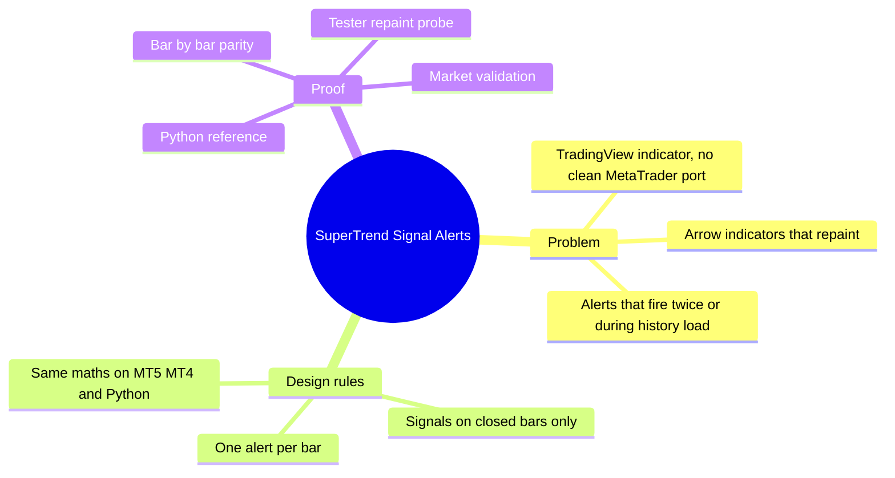

## How it works

### The maths, step by step

Let `O, H, L, C` be the bar's open, high, low, close, `i` the bar index (oldest = 0), `n` the ATR period and `m` the
multiplier.

1. **True range**

   `TR[i] = max(H[i]-L[i], |H[i]-C[i-1]|, |L[i]-C[i-1]|)`, and `TR[0] = H[0]-L[0]`.

2. **ATR**, one of two methods (input *ATR method*):

   - RMA / Wilder (default, same as `ta.atr` on TradingView): `ATR[n-1] = mean(TR[0..n-1])`, then
     `ATR[i] = (ATR[i-1] * (n-1) + TR[i]) / n`.
   - SMA of the true range: `ATR[i] = mean(TR[i-n+1..i])`.

3. **Source** `src[i] = (H[i] + L[i]) / 2`.

4. **Raw bands** `up = src - m * ATR[i]` and `dn = src + m * ATR[i]`. Let `up1` and `dn1` be the previous bar's final
   bands (on the first bar, the bar's own).

5. **Ratchet** (the bands only move with the trend):

   - if `C[i-1] > up1`: `up = max(up, up1)` (the lower band only rises)
   - if `C[i-1] < dn1`: `dn = min(dn, dn1)` (the upper band only falls)

6. **Trend** `trend[i]`, starting at `+1`:

   - if `trend = -1` and `C[i] > dn1`: `trend = +1`
   - if `trend = +1` and `C[i] < up1`: `trend = -1`
   - otherwise unchanged

7. **Line** `line[i] = up` when `trend = +1`, else `dn`. Blue in an uptrend, red in a downtrend.

8. **Signals** (on closed bars only):

   - Buy: `trend[i] = +1` and `trend[i-1] = -1`
   - Sell: `trend[i] = -1` and `trend[i-1] = +1`
   - EMA filter: a buy also needs `C[i] > EMA[i]`, a sell `C[i] < EMA[i]`, where `EMA` is seeded with the average of the
     first `p` closes and then `EMA[i] = EMA[i-1] + 2/(p+1) * (C[i] - EMA[i-1])`.
   - RSI filter: a buy also needs `RSI[i] > 50`, a sell `RSI[i] < 50`, with Wilder's RSI (gains and losses smoothed with
     the same seeded RMA).

A comparison "close above band" ignores floating-point noise below `1e-10` of the band, in the indicator and in the
Python reference alike: a band can tie a close exactly in real arithmetic, and a last-bit difference would otherwise
decide a trend flip differently in two languages. The filters change arrows and alerts only, not the line. The live bar's
line may move; arrows are never drawn on it.

### Per-bar algorithm

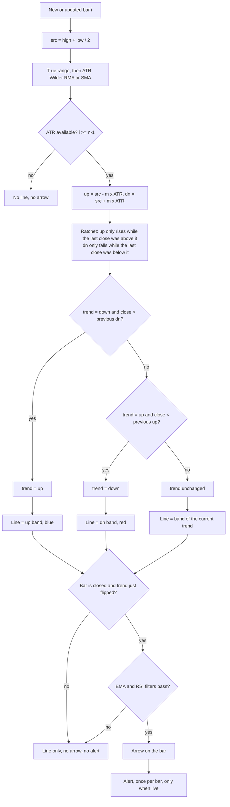

### Signal states

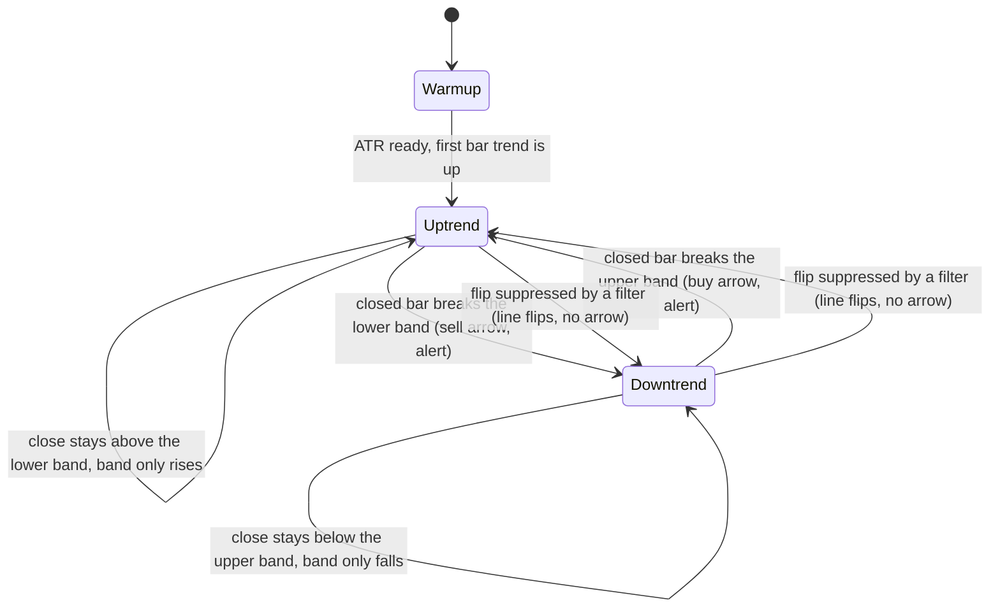

### Alert flow

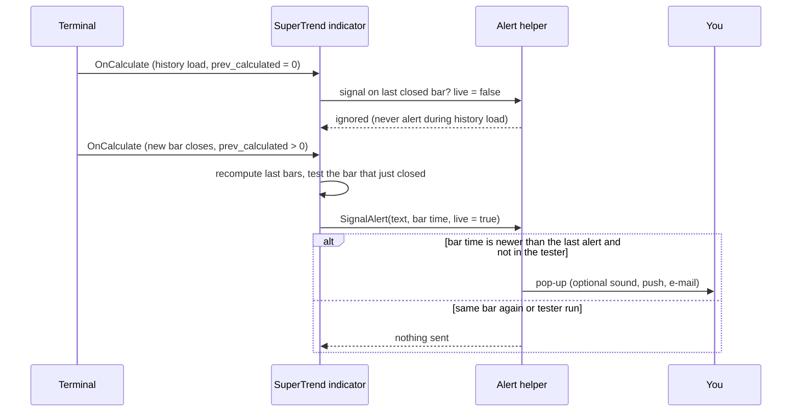

### What the multiplier does (measured)

A larger multiplier puts the bands further from price, so the trend flips later and less often. Arrows (buy plus sell) per
month on closed bars of broker history, 2023-10-01 to 2026-10-12 (36.3 months), ATR period 10, other inputs default.
Source: [`docs/data/arrows-per-month.json`](docs/data/arrows-per-month.json). This counts arrows only. It says nothing about
profit.

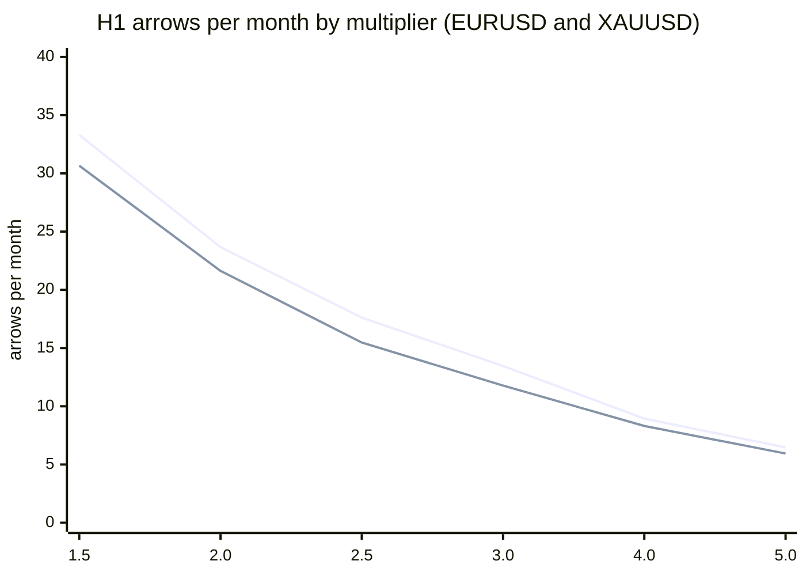

First line EURUSD, second XAUUSD.

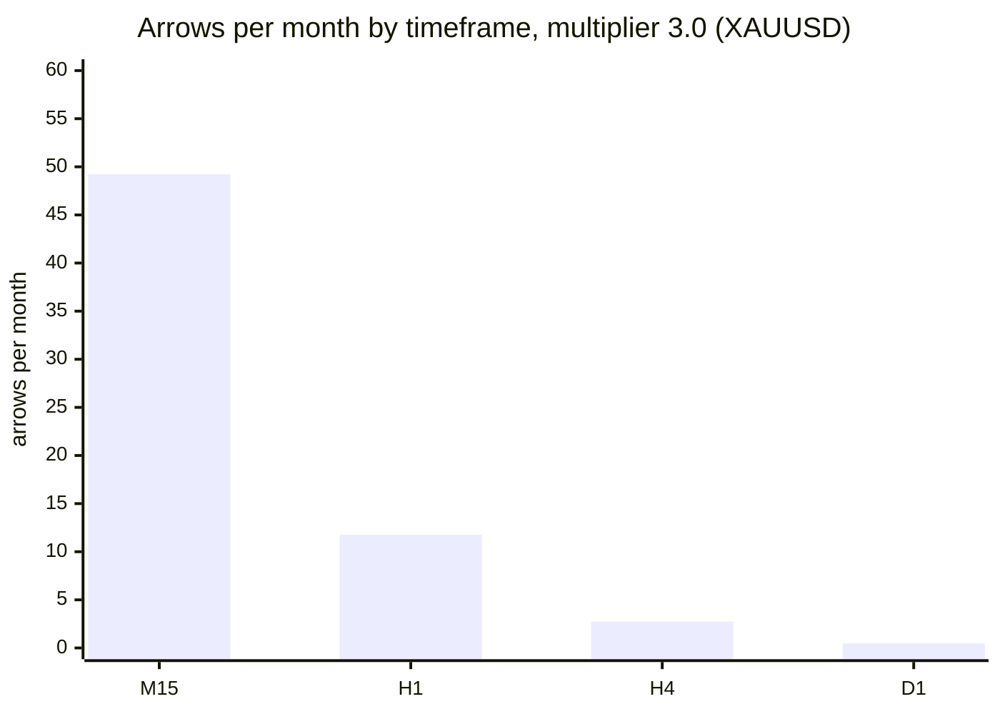

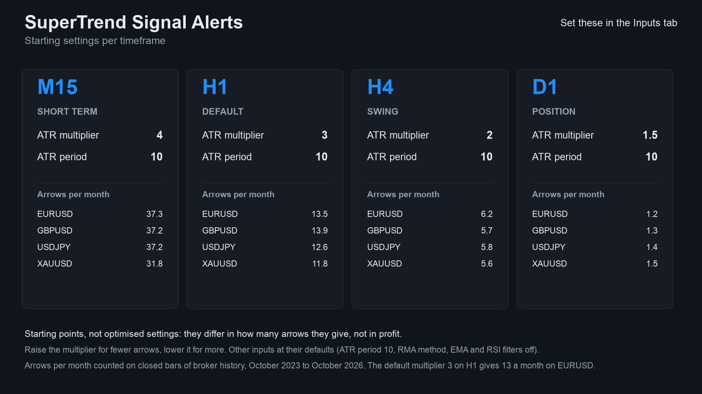

## Non-repainting: the proof and how it was tested

"Non-repainting" is easy to claim. Here is what was actually run. Raw result files are in [`tests/results/`](tests/results).

**1. Three implementations, compared bar by bar.** The Python reference
([`tests/reference.py`](tests/reference.py)) was written from the TradingView script's behaviour, not translated from the
MQL code. The MT5 and MT4 indicators were then dumped bar by bar (line, buy, sell buffers) in the MetaTrader Strategy
Tester, and [`tests/check_parity.py`](tests/check_parity.py) compared each dump with the reference. Pass means: every
closed bar's line within 1e-9 relative, and arrows on exactly the same bars.

| | MT5 | MT4 |
|---|---|---|
| dumps compared | 36 (4 symbols x M15/H1/H4 x 3 input sets) | 37 (same 36 + one every-tick EURUSD H1) |
| bars compared | 1,122,870 | 761,453 |
| arrows compared (buy + sell) | 30,823 | 22,525 |
| result | ALL PASS | ALL PASS |

Symbols: EURUSD, XAUUSD, GBPJPY, BTCUSD. Input sets: defaults; SMA ATR method with multiplier 2 and period 14; EMA and RSI
filters on. Source: [`tests/results/parity-mt5-and-mt4.txt`](tests/results/parity-mt5-and-mt4.txt). The MT5 M15 dumps cover
only 4,450 bars each (a short test history), and the MT4 test history is shorter on the FX pairs, which is why the bar
counts differ.

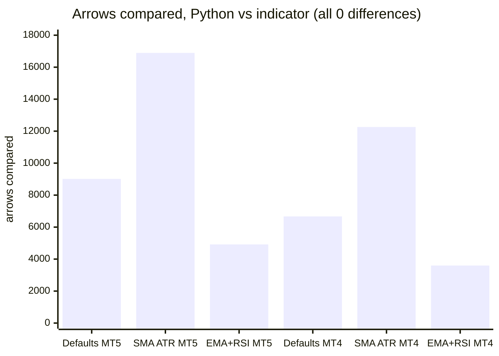

(MT4 "Defaults" is 6,514 arrows over 12 runs plus 153 in the every-tick run = 6,667.)

**2. Repaint probe.** An EA records which signal buffers are set on each bar *at the moment it closes*, then reads the same
bars again at the end and counts any value that changed. It also counts any signal ever shown on the still-forming bar.

| Run | Closed bars checked | Signals seen at close | Changed afterwards | Signals on the live bar |
|---|---|---|---|---|
| MT5, EURUSD H1, every tick, 10,411,052 ticks | 4,644 | 126 | **0** | **0** |
| MT4, 37 runs combined | 756,852 | 22,449 | **0** | **0** |

Source: [`tests/results/repaint-summary.md`](tests/results/repaint-summary.md). The MT5 repaint probe was run once (EURUSD H1,
default inputs); the MT4 probe ran on every dump run.

**3. Market validation.** Both Market builds passed the MQL5 Market's automated product validation before publication
(this is the Market's own check, not part of this repository).

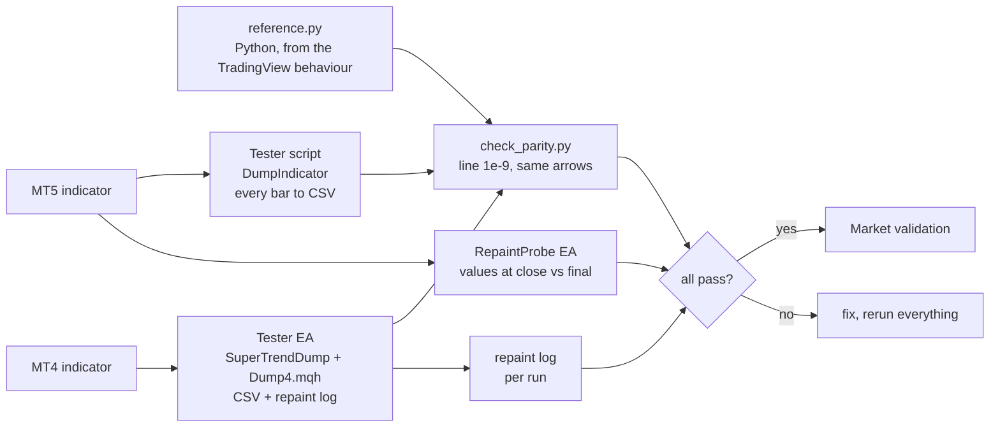

### Why the design cannot repaint

- Arrows are written only when `i <= rates_total - 2`, i.e. never on the forming bar.
- Each bar's bands and trend depend only on that bar and earlier bars (recursive formulas, no look-ahead).
- Alerts fire only for the bar that just closed, only after the history load, once per bar, and never in the tester.
- What *does* move: the line on the forming bar, because the live bar's high, low and close change. That is not a signal.

## Architecture and buffers

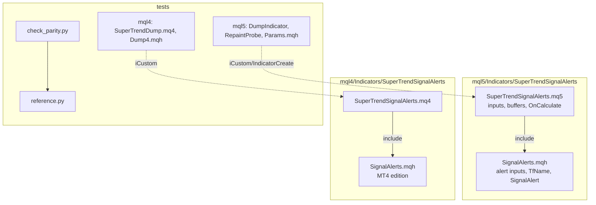

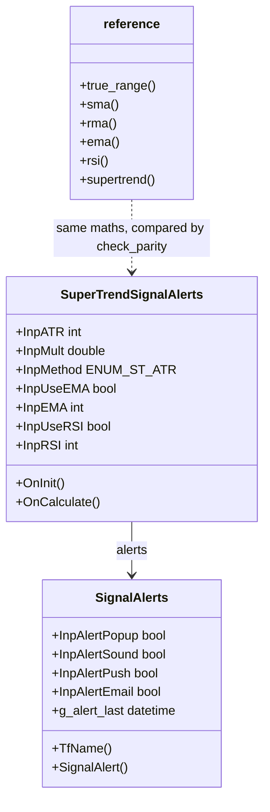

### `iCustom` buffer table (for EA developers)

| Buffer | MT5 | MT4 |
|---|---|---|
| 0 | SuperTrend line (colour line) | SuperTrend line (not drawn; read this one) |
| 1 | colour index of the line (0 blue, 1 red) | blue half of the drawn line |
| 2 | **Buy** arrow price (bar low), empty otherwise | **Buy** arrow price, empty otherwise |
| 3 | **Sell** arrow price (bar high), empty otherwise | **Sell** arrow price, empty otherwise |
| 4 | trend EMA (when the filter is on) | red half of the drawn line |
| 5 | calculation buffer | trend EMA (when the filter is on) |
| 6-12 (MT5) / 6-13 (MT4) | calculation buffers (bands, trend, ATR, EMA, RSI, gains, losses) | calculation buffers |

Empty value is `EMPTY_VALUE`. Read arrows on **closed bars** (shift 1 and higher). `iCustom` parameters follow the input
order: ATR period, ATR multiplier, ATR method, EMA filter, EMA period, show EMA, RSI filter, RSI period, show line, arrow
gap, pop-up, sound, sound file, push, e-mail. In MT5 the `input group` headings also count as string parameters when you
build a handle with `IndicatorCreate` (see `tests/mql5/Include/IndTest/Params.mqh`).

## Inputs, alerts, install and compile

| Input | Default | Meaning |
|---|---|---|
| ATR period | 10 | Length of the ATR |
| ATR multiplier | 3.0 | Band distance in ATRs. Lower: flips sooner and more often. Higher: later |
| ATR method | RMA / Wilder | RMA (same as `ta.atr`) or SMA of the true range |
| Only signals with the EMA trend | false | Buy only above the EMA, sell only below |
| EMA period | 200 | Length of the trend EMA |
| Draw the EMA | true | Show the EMA when the filter is on |
| Buy only RSI above 50, sell only below | false | RSI filter on arrows and alerts |
| RSI period | 14 | Length of the RSI |
| Draw the SuperTrend line | true | Show or hide the line (arrows stay) |
| Arrow distance from the candle | 12 px (MT5) / 0.3 x ATR (MT4) | Gap between arrow and candle |
| Pop-up alert | true | Terminal alert window |
| Play a sound / sound file | false / alert.wav | File from the terminal's Sounds folder |
| Push notification | false | Needs your MetaQuotes ID in Options |
| E-mail | false | Needs e-mail set up in Options |

**Alert text:** `SuperTrend EURUSD H1: BUY, trend up from 1.08512`.

**Install from source.** Copy `mql5/Indicators/SuperTrendSignalAlerts/` into `<terminal data folder>/MQL5/Indicators/` (MT5) or
`mql4/Indicators/SuperTrendSignalAlerts/` into `<data folder>/MQL4/Indicators/` (MT4), open `SuperTrendSignalAlerts.mq5` or
`.mq4` in MetaEditor and press Compile (F7). Both compile with 0 errors (checked on a Windows machine with MetaEditor; the
compiled files are not in the repository). Keep the two files of each edition together: the indicator includes
`SignalAlerts.mqh` from its own folder.

## Run the Python reference and the tests

```bash
python3 -m venv .venv && . .venv/bin/activate && pip install -r requirements.txt
```

```python
import sys; sys.path.insert(0, "tests")
import numpy as np
from reference import supertrend
# o, h, l, c are float arrays of OHLC bars, oldest first
line, buy, sell = supertrend(o, h, l, c, period=10, mult=3.0)   # buy/sell hold the arrow price or NaN
```

To repeat the parity check on your own data:

1. Compile the indicator and the test tool for your platform (`tests/mql5/Scripts/DumpIndicator`, or `tests/mql4/SuperTrendDump.mq4`
   with `tests/mql4/Include/IndTest4/Dump4.mqh` in your `MQL4/Include/IndTest4/`; MT5 also needs `tests/mql5/Include/IndTest/Params.mqh`).
2. Run it in the Strategy Tester (MT4) or as a script (MT5) for each symbol and timeframe, with the input sets in
   `tests/configs.tsv` (MT5) / `tests/mql4/configs.tsv` (MT4). The tool writes one CSV per symbol and timeframe.
3. `python3 tests/check_parity.py <folder with the CSVs>`. It prints PASS or FAIL per file and an overall result (the file
   names must start with the tags `st_default`, `st_sma_m2_p14`, `st_ema_rsi`).
4. Repaint: run `tests/mql5/Experts/RepaintProbe` in the MT5 Strategy Tester (every tick); MT4 writes its repaint log with the dump.

The price dumps used for the published numbers are not in this repository (they are broker price data).

## Honest limits

- **An indicator signal is not a strategy.** No stop-loss, position sizing or exit rules are provided or implied, and the
  arrows were not optimised or back-tested for profit. Whether a trend flip makes money depends on your market, costs and rules.
- **No profit or accuracy claim is made.** The only numbers here are about *consistency* (the three implementations agree,
  signals do not move) and *frequency* (arrows per month).
- **Lag is built in.** The line turns after the move has started; a higher multiplier turns later still.
- **Sideways markets** produce frequent flips; the EMA and RSI filters reduce some of them but not all.
- **Data-dependent.** ATR is seeded from the first bars in the terminal's history, so the very first arrows of a short
  history can differ from a longer one.
- **Scope of the tests.** Four symbols, three timeframes, three input sets, one MT5 repaint run. Other symbols and
  timeframes are not covered by the published numbers. The MT5 build was not run on a live chart as part of these numbers.

## Free, with no paid edition

SuperTrend Signal Alerts has no paid sibling: the Market builds and this source are the same free indicator, with every
input described above. Website: [allanninal.dev/mql5](https://www.allanninal.dev/mql5/#indicators)
([MT4](https://www.allanninal.dev/mql5/#mt4)).

## Licence and credits

**Origin of the maths.** SuperTrend is a trend-following indicator created by **Olivier Seban**. The TradingView
**"SuperTrend"** script, which many traders know it by, is by **KivancOzbilgic**; it is open source on TradingView. Thank
you to both.

**What this means for the licence.** TradingView publishes open-source scripts under the Mozilla Public License 2.0 unless
the author states another licence. I did not confirm what licence the original script's header states, so I took the
conservative route: the three files that implement the SuperTrend calculation are licensed **MPL-2.0**:

- `mql5/Indicators/SuperTrendSignalAlerts/SuperTrendSignalAlerts.mq5`
- `mql4/Indicators/SuperTrendSignalAlerts/SuperTrendSignalAlerts.mq4`
- `tests/reference.py`

They are independent implementations in other languages (the Python one written from the script's described behaviour,
not translated), plus additions (closed-bar signals, alerts, EMA and RSI filters), but treating them as derived from an
MPL-2.0 work is the safe reading. MPL-2.0 is file-level: changes to those files must stay MPL-2.0 and be shared.

Everything else (alert helper `SignalAlerts.mqh`, test tools, parity checker, docs, images) is © 2026 Allan Niñal under the
[PolyForm Noncommercial License 1.0.0](LICENSES/PolyForm-Noncommercial-1.0.0.md): free for personal and other
noncommercial use, not for commercial use (source-available, not OSI open source). Each source file has an
`SPDX-License-Identifier` line. Texts: [`LICENSE`](LICENSE), [`LICENSES/MPL-2.0.txt`](LICENSES/MPL-2.0.txt). The licence
applies to this source, not to anything you build or trade with the indicator. Trading involves risk; the software is
provided as is.

---

**Website:** [allanninal.dev/mql5](https://www.allanninal.dev/mql5/#indicators) · [MT4](https://www.allanninal.dev/mql5/#mt4) · [allanninal.dev](https://www.allanninal.dev)
· Questions: message me on [LinkedIn](https://www.linkedin.com/in/allanninal/).
